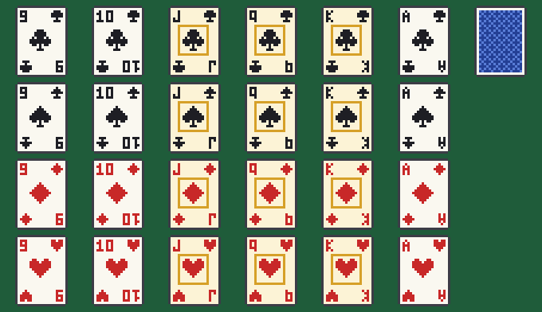
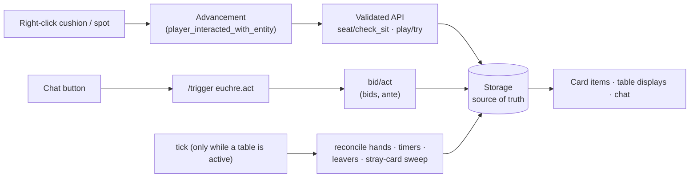

# Euchre for Minecraft

[](https://github.com/jackmcnulty/euchre-minecraft-datapack/actions/workflows/ci.yml)


A complete, **rules-enforcing game of Euchre** for Minecraft Java Edition 26.3. It's played at a table you build yourself in a survival world. Four players sit on cushions, bid with clickable chat buttons, and play cards from their hotbar onto the table. The datapack enforces every rule: the bowers, effective suit, following suit, both bidding rounds, going alone, and scoring to a target. Tables can be free, or played for **diamond stakes held in auditable escrow**.

It's a pure vanilla **datapack** plus a small **resource pack** for the card art. There are no mods or plugins.

> **Status:** v0.9.1 is a feature-complete pre-release for playtesting; 1.0.0 follows after real-player QA.

<!-- TODO: demo GIF of a hand being played -->



## Features

- **The full game:** a 24-card deck, two partnerships, both bidding rounds, the dealer's pickup and discard, stick-the-dealer or redeal, going alone, and scoring to a configurable target.
- **Rules enforced, not suggested:** illegal plays are refused with a reason. The left bower counts as trump everywhere, including when following suit.
- **Physical table:** cushions you place become seats. Cards go into your hotbar and lie face up on the table when played. Floating displays show the score, trump and whose turn it is.
- **No peeking:** you see your cards' faces, and everyone else sees the backs.
- **Survival-safe:** cards are inert items survival players can't obtain, and they exist only during a game. On free tables the datapack never creates or removes anything of value.
- **Diamond wagers:** all-or-nothing stake collection, escrow, winner payouts, refunds whenever a game is cancelled, and payouts delivered to players who were offline. A conservation check on every change, plus an audit log.
- **Resilient:** players can stand up, disconnect, or sit through a server restart mid-game and pick up where they left off. A grace period decides forfeits.
- **Tested:** 26 automated in-game test suites with over 1,200 assertions, about 900 of them generated from an independent rules model. They run in CI on every push.

## Install

1. Download `euchre-datapack-<version>.zip` and `euchre-resourcepack-<version>.zip` from [Releases](https://github.com/jackmcnulty/euchre-minecraft-datapack/releases).
2. Put the datapack zip in `<world>/datapacks/` and run `/reload`, or select it when creating a world.
3. Give every player the **resource pack**. It draws the cards. Without it, cards still work and show their names (like "A♥"), but look like a missing texture.
   - **Server:** host the zip somewhere public, then in `server.properties` set `resource-pack=<url>`, `resource-pack-sha1=<sha1 of the zip>` and, ideally, `require-resource-pack=true`.
   - **Single player / LAN:** put the zip in `.minecraft/resourcepacks/` and enable it.

The resource pack only adds new `euchre:` models, so it doesn't change the look of any vanilla item.

## Building a table

```
            [cushion]
     ┌───────────────────┐
     │      spot N       │
[c]  │ spot W  ◆  spot E │  [c]      ◆ = where you stand to run setup
     │      spot S       │
     └───────────────────┘
            [cushion]
```

1. Build a table from any blocks: 1×1, 3×3, whatever you like.
2. Place **4 cushions** around it, one on each side, within 3 blocks of the centre. The cushions stay yours: the datapack never breaks or moves them. While they're part of a table, they **can't be broken by a punch** (creative-mode players can still break them, and pistons and lava still destroy them). They become ordinary cushions again when the table is removed.
3. Stand on the **centre of the tabletop** and run one of:

```mcfunction
/function euchre:setup                               # free play, first to 5
/function euchre:setup_custom {wager:0,target:10}    # free play, first to 10
/function euchre:setup_custom {wager:10,target:5}    # each player stakes 10 diamonds
/function euchre:setup_advanced {wager:10,target:5,stick_dealer:1,grace_s:120}
```

| Option | Range | Meaning |
|---|---|---|
| `wager` | 0–256 | Diamonds each player stakes. `0` = free play. |
| `target` | 1–25 | Points needed to win. |
| `stick_dealer` | 0 or 1 | `1` (default): if everyone passes twice, the dealer must name trump. `0`: redeal. |
| `grace_s` | 30–600 | Seconds a player who leaves mid-game has to come back (default 120). |

The config is fixed for the table's lifetime and shown on its display. To change it, remove the table and set it up again. Invalid values are refused with a message.

## How to play

| | |
|---|---|
| **Sit** | Right-click a cushion. You need **5 empty hotbar slots** for your cards; your own items are never moved. Sneak to stand up. |
| **Deal** | When four players are seated, the cards are shuffled and dealt, and one card is turned up in the middle of the table. |
| **Bid** | On your turn, buttons appear in your chat. **Round 1:** order up the up card's suit, alone or not, or pass. If someone orders up, the dealer picks up the up card and discards one. **Round 2:** name any other suit, alone or not, or pass. |
| **Play** | On your turn, hold a card and right-click the spot in front of you. You must follow suit if you can. The best card takes the trick, and its player leads the next one. |
| **Score** | The makers score 1 for 3–4 tricks and 2 for all five (4 if alone). Euchred makers give the other team 2. The first team to the target wins, and a new game starts if everyone stays seated. |
| **Leave** | Standing up or disconnecting mid-game pauses the game and holds your seat. Sit back down to resume, and your cards come back. If you're not back within the grace period, your team forfeits. If both teams have someone away, the game is cancelled. |

The table's state is the source of truth for every hand. A card you drop, hand to someone or stash comes back to you, and duplicates disappear.

## Rules supported

| Rule | How it's handled |
|---|---|
| Deck | 24 cards: 9, 10, J, Q, K, A in four suits. Fisher–Yates shuffle with `/random`. |
| Partnerships | Partners sit opposite: North/South vs East/West. The deal rotates clockwise. |
| Trump ranking | Right bower > left bower > A > K > Q > 10 > 9. The left bower *is* trump for all purposes. |
| Following suit | Required when possible, by effective suit. Illegal cards are refused. |
| Round 1 | Order up or pass, starting left of the dealer. The dealer picks up the up card and discards. |
| Round 2 | Name any suit except the turned-down one. Stick-the-dealer or redeal, per table. |
| Going alone | The partner sits out and tricks have 3 cards. If the dealer is the one sitting out, they don't pick up. |
| Scoring | 1 / 2 / 4 (lone march), and euchre = 2 to the defenders. The game is played to the table's target. |

## Wagered tables

Players confirm their stake in chat before the first deal. **Collection is all-or-nothing:** if anyone is short, nobody pays. Only unmodified diamonds count, so a renamed or tagged diamond is never touched. The winners split the pot. **Every stake is refunded** if the game is cancelled: the table is removed, an operator aborts, or both teams abandon it. Diamonds owed to offline players are delivered when they return. If an inventory is full, the overflow drops at the player's feet, can only be picked up by them, and never despawns.

Every diamond movement goes through exactly two generated functions. A ledger enforces *collected = delivered + held + owed* after every change, and an audit log records each event. **[docs/escrow.md](docs/escrow.md)** explains it all for server admins.

## Operator commands

| Command | What it does |
|---|---|
| `euchre:setup`, `setup_custom`, `setup_advanced` | Create a table (see above). |
| `euchre:remove_table` | Remove the nearest table (within 8 blocks). Refunds stakes, stands players up and releases the cushions. |
| `euchre:rebind` | A cushion was broken or taken: place a new one on that side and run this. |
| `euchre:abort` | Cancel the game at the nearest table and refund every stake. |
| `euchre:admin/inspect` | Show the ledger, plus the nearest table's config, seats and escrow. |
| `euchre:admin/pending_list` · `admin/audit_log` | Show payouts owed to offline players, or the audit log. |
| `euchre:admin/notify_on` · `notify_off` | Get escrow events in chat as they happen. |
| `euchre:admin/unfreeze` | Re-enable wagers after reviewing a ledger mismatch. |
| `euchre:admin/release_pending` | Take all pending payouts yourself, to hand them out manually. |
| `euchre:uninstall` | Remove everything (see below). |

## Architecture

Everything happens in vanilla commands. Clicks arrive as advancements, chat buttons as `/trigger`, and the tick function does almost nothing while no table is in use.



- **The game state machine** has phases `IDLE → (ANTE) → DEAL → BID1 → (DISCARD) → (BID2) → PLAY ⇄ TRICK_END → … → GAME_OVER`, with `PAUSED` reachable from any in-game phase.
- **Rules are pure scoreboard functions** (`rules/*`), tested against a Python reference model.
- **The design is multi-table ready:** every entity carries a table id, and all state is keyed by it. Only setup's one-table check would change.

See **[docs/architecture.md](docs/architecture.md)** for the state machine diagram, the data model, and the reasoning behind each decision.

## Quality and testing

- **CI** (GitHub Actions) runs on every push:
  - lint and the generated-file check;
  - the **PackTest** suite on a Fabric 26.3 server;
  - a **vanilla** 26.3 server smoke test, so the shipped pack is proven on an unmodded server.
- **Tests** play real games with fake players: clicking cushions and spots, pressing chat buttons, disconnecting and rejoining, and staking diamonds. They check exact diamond counts and every ledger change.
- **Golden tests** are generated from `tools/gen.py`'s reference model. They cover every card under every trump and led suit, 150 follow-suit decisions, 60 random tricks, and every scoring case.
- **`tools/lint.py`** catches what Minecraft only reports at load time, plus project invariants:
  - only the two escrow functions touch diamonds;
  - no `minecraft:` writes, and everything uses the `euchre` prefix;
  - cushions are never killed;
  - no score overflow from position maths;
  - no invalid NBT paths, and quotes and brackets balance;
  - phase dispatch tables return after their first match;
  - every function and resource-pack reference resolves.
- **Generated code** (`tools/gen.py`) covers the repetitive files: per-card helpers, chat prompts, the card table, the objective list and the card art. Everything generated is committed, so the repo stays a drop-in pack, and CI fails if a generated file is stale.

See **[docs/testing.md](docs/testing.md)** for how to run the tests locally, plus the manual QA checklist.

## Prior art

As far as I know, there was no Euchre datapack, mod or plugin before this one. Related projects include a physical blackjack datapack, and card packs such as *Poker Pack* and *Deal With It*. They provide cards or simple games, but nothing enforces a trick-taking game's rules. That's this project's difference.

## Uninstall

1. Run `/function euchre:uninstall`. It removes every table first, refunding all stakes (offline players' refunds become pending). It **refuses to finish while diamonds are still owed**: wait for those players to log in, or run `euchre:admin/release_pending` and hand the diamonds out yourself.
2. Run `/datapack disable "file/<pack name>"` (see `/datapack list`) and delete the pack.

## Good to know

- **One table per world** for now.
- **A seated player who logs out takes their cushion with them.** That's vanilla: a vehicle is saved with its rider. The cushion returns when they do. If they never come back, place a new cushion and run `euchre:rebind`.
- Cards are dealt only into **hotbar** slots, and the dealer needs a 6th free slot for the up card.

## Development

```bash
python tools/gen.py      # regenerate generated files (commit the result)
python tools/lint.py     # static checks
python tools/build.py    # gen --check + lint + release zips into dist/
```

These need only Python 3.10+, with no extra packages. `spike/` is a throwaway datapack used to verify 26.3 behaviour in-game; the findings are in [docs/verification.md](docs/verification.md). Releases are built by CI when a `v*` tag is pushed.

## License

MIT. See [LICENSE](LICENSE).
