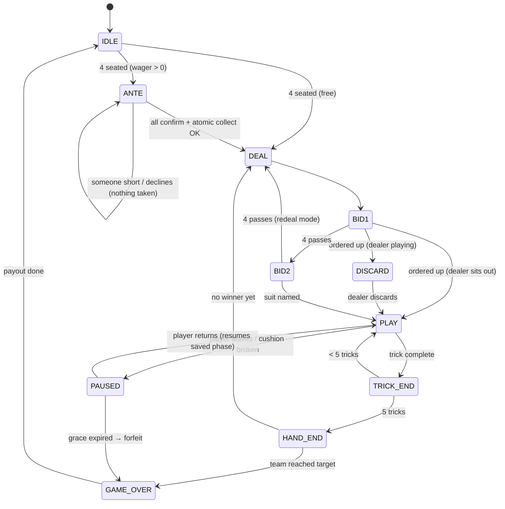

# Architecture

This document is a summary of the design. The milestone plan in the repo history has the full reasoning.

## Principles

1. **Storage is the source of truth.** Card items in a player's hotbar are only a view of the state in storage. A card is playable only if the state says that player holds it, and its `nonce` matches the live game.
2. **Event-driven, near-zero idle cost.** Clicks arrive through advancements. The tick function returns after a single score check (`#active`) when no table needs work.
3. **Multi-table ready.** Every table entity carries an `euchre.tid` score. Handlers run as the table marker and work on a copy of that table's storage record (`euchre:cur`). Supporting a second table needs no rewrite.
4. **Diamonds go through two choke points.** Only `escrow/collect` takes diamonds and only `escrow/deliver` gives them. A ledger invariant is asserted after every change. `tools/lint.py` enforces the choke points in CI.
5. **Never touch players' own things.** The builder places the cushions, which the datapack only tags and never kills. Player items are never moved, apart from staked diamonds.

## Table layout

```
              [cushion N]
                 spot N
 [cushion W] spot W  ◆  spot E [cushion E]      ◆ = marker (operator stands here to run setup)
                 spot S
              [cushion S]
```
Seats are numbered clockwise: N=0, E=1, S=2, W=3. Partners sit opposite each other, so the teams are N/S (0) and E/W (1), and a seat's team is `seat % 2`.

## State machine


Every in-game phase can go to PAUSED, not just PLAY; the diagram shows only PLAY to keep it readable.

## Decisions

| Topic | Decision |
|---|---|
| Seats | Cushions (26.3) placed by the builder. `euchre:setup` adopts the 4 nearest and tags them. |
| Leaver | The game pauses for `grace_s` (default 120 s) and the seat is reserved by UUID. If the player doesn't return, their team forfeits. If both teams have a leaver, or after a server restart, the game aborts with refunds. |
| Full inventory on payout | `/give` overflow drops at the player's feet, owner-only and non-despawning. |
| All pass in round 2 | Stick the dealer by default (`stick_dealer` config). |
| Lone maker's partner is the dealer | The dealer sits out and does not pick up the upcard. |
| Tests | PackTest (Fabric) in CI only. A vanilla smoke job confirms the pack loads on an unmodded server. |
| Build tooling | Hand-written `.mcfunction` plus `tools/gen.py` (stdlib Python) for the repetitive parts. Generated files are committed. |

## Data model

See `datapack/data/euchre/function/load.mcfunction` for the full list of objectives.

**Storage**

| Storage | Contents |
|---|---|
| `euchre:tables list[]` | Per table: `{id, config, seats, hands, kitty, trick, ante, escrow, leave}` |
| `euchre:pending list[]` | Diamonds owed to offline players, keyed by UUID |
| `euchre:audit log[]` | The last 256 escrow events |
| `euchre:cards table[]` | The generated card lookup table |
| `euchre:defaults setup` | Default table config |
| `euchre:meta schema` | Storage schema version |

**Cards**

- Card id = `suit * 6 + rank`.
- Suits: ♣0 ♠1 ♦2 ♥3, so the same-colour suit is `suit XOR 1`.
- Ranks: 9 10 J Q K A = 0–5.
