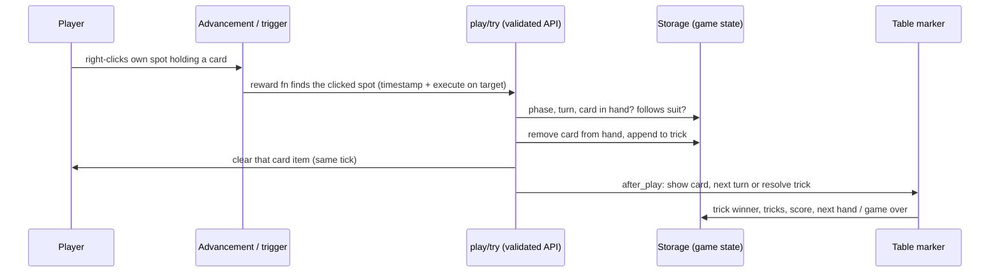

# Architecture

## Principles

1. **Storage is the source of truth.** Card items in a hotbar are only a view of
   the hands in storage. A card is playable only if storage says its player
   holds it, and its deal id (`nonce`) matches the live deal. Every 10 ticks,
   each hand is reconciled against storage.
2. **Event-driven; near-zero idle cost.** Clicks arrive as advancements, choices
   as `/trigger`. While no table is in use, the tick function makes two cheap
   checks and nothing else. A 5-second heartbeat recounts active tables.
3. **Validated internal APIs.** Every player action goes through one function
   that checks phase, turn, ownership and distance: `seat/check_sit`,
   `bid/act` and `play/try`. Clicks and chat buttons are thin adapters over
   them, and the tests call them directly.
4. **Pure rules engine.** `rules/*` are scoreboard-only functions with
   documented inputs and outputs. They're tested against a reference model in
   `tools/gen.py`.
5. **Diamonds have two choke points.** Only `gen/escrow_collect` removes
   diamonds and only `gen/escrow_give` gives them. A ledger invariant is
   asserted after every change. See [escrow.md](escrow.md).
6. **Never touch players' things.** Cushions belong to the builder: they're
   tagged, never killed. Player items are never moved; the game waits for space
   instead. The only exception is diamonds explicitly staked.
7. **Multi-table ready.** Every entity carries an `euchre.tid` score, and all
   state is keyed by table id. Only setup's one-table check is a single-table
   assumption.

## Repository layout

```
datapack/data/euchre/function/
  setup*, remove_table, rebind, abort, uninstall   public entry points
  table/        setup, display, tick, removal
  seat/         sitting, standing, returning, vacating
  player/       identity (pid, UUID, name), rejoin
  deck/         shuffle
  game/         start, deal, timers, win/finish/abort, cleanup
  bid/          both rounds, pickup/discard, going alone
  play/         card play, tricks, hand scoring
  rules/        pure rules engine
  leave/        pause, grace period, forfeit, resume
  escrow/       ante, collection, payout, refunds, pending, ledger, audit
  admin/        operator tools
  gen/          GENERATED (tools/gen.py): card items, prompts, escrow choke points
resourcepack/assets/euchre/   GENERATED card art, models, item model definitions
tests/packtest/               PackTest suites (CI only); test/golden is GENERATED
tools/                        gen.py, cardart.py, lint.py, build.py, smoke_vanilla.py
spike/                        throwaway pack used to verify 26.3 behaviour in-game
```

## Game state machine

`euchre.phase` on the table's marker entity:

```mermaid
stateDiagram-v2
    [*] --> IDLE
    IDLE --> ANTE: 4 seated, wager > 0
    IDLE --> DEAL: 4 seated, free table
    ANTE --> ANTE: someone short (nothing taken)
    ANTE --> IDLE: a player leaves (nothing taken)
    ANTE --> DEAL: all confirm, atomic collection OK
    DEAL --> BID1: shuffle pause, deal, up card shown
    BID1 --> DISCARD: ordered up (dealer plays)
    BID1 --> PLAY: ordered up, dealer sits out a lone hand
    BID1 --> BID2: four passes, up card turned down
    DISCARD --> PLAY: dealer discards
    BID2 --> PLAY: suit named
    BID2 --> DEAL: four passes, stick_dealer off (redeal)
    PLAY --> TRICK_END: trick complete
    TRICK_END --> PLAY: fewer than 5 tricks
    TRICK_END --> DEAL: hand scored, no winner yet
    TRICK_END --> GAME_OVER: a team reaches the target (payout)
    GAME_OVER --> IDLE: pause; then ANTE/DEAL again if 4 still seated
    PLAY --> PAUSED: a player leaves
    PAUSED --> PLAY: everyone back (resumes the saved phase)
    PAUSED --> GAME_OVER: grace expired, one team away (forfeit, payout)
    PAUSED --> IDLE: grace expired, both teams away (cancel, refund)
```



`PAUSED` (10) can be entered from any in-game phase, 2–8, not only `PLAY`. The
phase to return to is kept in `euchre.resume`, and phase timers freeze while
paused.

| # | Phase | | # | Phase |
|---|---|---|---|---|
| 0 | IDLE | | 6 | PLAY |
| 1 | ANTE | | 7 | TRICK_END |
| 2 | DEAL | | 8 | HAND_END |
| 3 | BID1 | | 9 | GAME_OVER |
| 4 | DISCARD | | 10 | PAUSED |
| 5 | BID2 | | | |

## Event flow



## Data model

**Entities.** Ours carry `euchre.entity` plus `euchre.tid`. The cushions don't
carry `euchre.entity`, so they can never be swept up when a table is removed.

| Entity | Tag | Notes |
|---|---|---|
| `marker` | `euchre.table` | Table anchor; holds the per-table scores. |
| `cushion` ×4 | `euchre.seat` | **Builder's own**; `euchre.seat` = 0 N, 1 E, 2 S, 3 W (clockwise). |
| `interaction` ×4 | `euchre.spot` | Card spots on the tabletop. |
| `item_display` | `euchre.card_shown` | The up card and played cards (`euchre.trick_card`). |
| `text_display` | `euchre.board`, `euchre.seat_label` | Main board and per-seat labels. |

**Scores.** All objectives are listed once in `tools/gen.py`.

- **Global**, as fake players in `euchre.g`:
  - `#active` (tables that need tick work)
  - `#next_tid`, `#next_pid`, `#nonce`
  - escrow ledger: `#collected`, `#delivered`, `#held`, `#owed`, `#frozen`
  - constants
- **Per player:**
  - `euchre.pid`
  - `euchre.tid` and `euchre.seat` (while seated)
  - `euchre.act` (the trigger)
  - `euchre.left` (`leave_game` statistic)
- **Per table** (on the marker):
  - game flow: `phase`, `resume`, `timer`, `deadline` (game time)
  - the hand: `dealer`, `turn`, `leader`, `trump`, `led`, `upcard`, `maker`, `alone`, `bids`
  - trick and score counts: `trickno`, `tricks0/1`, `pts0/1`
  - `seated`, `nonce`, `pot`

**Storage**

| Storage | Contents |
|---|---|
| `euchre:tables list[]` | `{id, config:{wager,target,stick_dealer,grace_s}, seats:[{pid,uuid,name,away?}×4], ante:[b×4], escrow:{entries:[{uuid,name,amount}]}, game:{hands:[[ids]×4], kitty, trick:[{seat,card}], nonce}}` |
| `euchre:pending list[]` | `{uuid, name, amount, reason}`: diamonds owed to offline players |
| `euchre:audit log[]` | `{t, kind, uuid, name, amount}`, last 256 |
| `euchre:cards table[]` | Generated: `{id, suit, rank, name, color, key}` |
| `euchre:const` | Seat, team, suit and phase names |
| `euchre:defaults setup` | Default table config |
| `euchre:meta schema` | Storage schema version |
| `euchre:debug` | Test hooks only: `rig` (deck order), `dealer` (first dealer) |

**Cards.**
- Card id = `suit × 6 + rank`. Suits are ♣0 ♠1 ♦2 ♥3, so a suit's colour-mate is
  `suit XOR 1`. Ranks are 9 10 J Q K A = 0–5.
- Card items are debug sticks carrying
  `custom_data={euchre:{card,tid,nonce}}` and `item_model="euchre:card_<id>"`.

**Rules engine registers** (`euchre.tmp`):

| Function | In | Out |
|---|---|---|
| `rules/eff_suit` | `#card`, `#trump` | `#eff`, `#suit`, `#rank` |
| `rules/power` | `#card`, `#trump`, `#led` | `#power`: right bower 20, left 19, trump 12+rank, led suit rank+1, else 0 |
| `rules/is_legal` | `#card`, `#trump`, `#led`, hand in `euchre:tmp gh` | success if legal |
| `rules/trick_winner` | `#trump`, trick in `euchre:tmp game.trick` | `#winner` |
| `rules/score_hand` | `#mteam`, `#mtricks`, `#alone` | `#pteam`, `#pts` |

## Decisions

| Topic | Decision | Why |
|---|---|---|
| Seats | Cushions (new in 26.3) placed by the builder; setup adopts them | A cushion breaks into an item, so summoning them would create items of value. |
| Card item | `debug_stick` with per-card `item_model` | It can't be obtained in survival and is inert there (verified), and the base item is never re-skinned. |
| Leavers | Seat held; resume on return; forfeit after `grace_s`, or cancel if both teams left | Deters rage-quitting with stakes on the table, without punishing both sides for a crash or restart. |
| Full inventory payout | Owner-only drop that never despawns | Never lost; only the owner can take it. |
| All pass twice | Stick the dealer by default (configurable) | Common house rule; every deal gets played. |
| Lone maker's partner is the dealer | The dealer sits out and doesn't pick up | Standard rule. |
| Tests | PackTest (Fabric) in CI only, plus a vanilla smoke test | Readable mcfunction tests with fake players; the shipped pack stays vanilla. |
| Build tooling | Hand-written mcfunction plus stdlib-only `tools/gen.py`; generated files committed | Plain, reviewable commands; a drop-in pack straight from git; no toolchain to install. |
| Rejoin detection | `leave_game` statistic, plus a check that each seated player is online | The statistic counts Save & Quit and crashes (verified); the online check catches anything else. |

Version-specific behaviour this relies on is recorded, with how each item was
verified, in [verification.md](verification.md).
